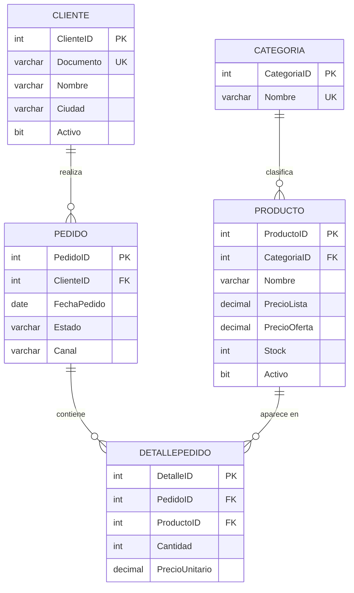

# NovaMarket — Examen PA2 - Programación Avanzada de Base de Datos
Repositorio que contiene un conjunto de scripts el proyecto **NovaMarket**: creación y población de la base de datos `NovaMarket_EP02`, subconsultas, mantenimiento de datos (INSERT / UPDATE / DELETE controlados), vistas, generación masiva de datos de prueba y reportes de clientes.
## Integrantes del equipo

| N° | Nombre completo                      | Correo institucional  | Aporte |
|----|--------------------------------------|-----------------------|--------|
| 1  | Imanol Ponce de León                 | 76221830@mail.isil.pe |  100%  |
| 2  | Jose Manuel Aponte Tanta             | 75619512@mail.isil.pe |  100%  |
| 3  | Andrés Francisco Pimentel Saldaña    | 73213777@mail.isil.pe |  0%    |
| 4  | Jhonn Paul Ccasani Enciso            | 44061898@mail.isil.pe |  0%    |

## 📹 Link YouTube: *(pegar aquí el enlace del video de la EP02)*

## 📋 Estructura del Proyecto

Los scripts están numerados en el orden en que deben ejecutarse:

| Script | Sesión | Contenido |
|--------|--------|-----------|
| `00_esquema_y_datos_base.sql` | Base | Creación de la BD, tablas, restricciones y datos iniciales |
| `01_s04_subconsultas.sql` | S04 | Subconsultas correlacionadas (`EXISTS` / `NOT EXISTS`) y subconsultas escalares |
| `02_s05_mantenimiento.sql` | S05 | Carga histórica idempotente, `UPDATE` condicionado y `DELETE` protegido |
| `03_s06_vistas.sql` | S06 | Vistas de ventas por categoría/mes y clientes sin compra en 2026 |
| `04_s07_datos_prueba.sql` | S07 | Generación masiva de pedidos y detalles (`WHILE` + `CURSOR`) |
| `05_s07_reporte_clientes.sql` | S07 | Reporte de pedidos y monto vendido por cliente en 2026 |

## 🗄️ Modelo de Datos y Restricciones

La base de datos **`NovaMarket_EP02`** consta de 5 tablas relacionadas:

### 1. Tabla `Categoria` 🟣
* **Propósito:** Clasifica los productos del catálogo.
* **Campos:** `CategoriaID` (**PK**, `IDENTITY`), `Nombre` (`UNIQUE`, `NOT NULL`).
* **Relación:** Una categoría tiene **muchos** productos (1 a N).

### 2. Tabla `Cliente` 🟢
* **Propósito:** Almacena a los compradores registrados.
* **Campos:** `ClienteID` (**PK**, `IDENTITY`), `Documento` (`UNIQUE`, `NOT NULL`), `Nombre`, `Ciudad`, `Activo` (`DEFAULT 1`).
* **Relación:** Un cliente puede realizar **muchos** pedidos (1 a N).

### 3. Tabla `Producto` 🔵
* **Propósito:** Catálogo de productos de redes, seguridad y accesorios.
* **Campos:** `ProductoID` (**PK**, `IDENTITY`), `CategoriaID` (**FK**), `Nombre`, `PrecioLista`, `PrecioOferta` (acepta `NULL`), `Stock`, `Activo` (`DEFAULT 1`).
* **Relación:** Pertenece a una categoría y puede aparecer en **muchos** detalles de pedido.

### 4. Tabla `Pedido` 🟠
* **Propósito:** Cabecera de cada pedido realizado por un cliente.
* **Campos:** `PedidoID` (**PK**, `IDENTITY`), `ClienteID` (**FK**), `FechaPedido`, `Estado`, `Canal`.
* **Restricción:** `CHECK` en `Estado` → solo admite `CONFIRMADO`, `PENDIENTE`, `ANULADO` o `BORRADOR`.
* **Relación:** Pertenece a un cliente y contiene **muchos** detalles.

### 5. Tabla `DetallePedido` 🔴
* **Propósito:** Detalle línea por línea de cada pedido; resuelve la relación **muchos a muchos** entre `Pedido` y `Producto`.
* **Campos:** `DetalleID` (**PK**, `IDENTITY`), `PedidoID` (**FK**), `ProductoID` (**FK**), `Cantidad`, `PrecioUnitario` (precio al momento de la venta).

### 📦 Datos base cargados (`00_esquema_y_datos_base.sql`)

| Tabla | Registros |
|-------|-----------|
| Categoria | 3 (Redes, Seguridad, Accesorios) |
| Cliente | 15 |
| Producto | 12 |
| Pedido | 13 (3 históricos de 2025 y 10 de 2026) |
| DetallePedido | 14 |

## 🔎 Resumen de Scripts

### 🔹 `01_s04_subconsultas.sql` — Subconsultas

* **Consulta 1: `EXISTS` + `NOT EXISTS`.** Clientes que compraron al menos un producto de **Redes** en un pedido `CONFIRMADO` de 2026 y que **no** tienen compras confirmadas de **Seguridad** en 2026. Con los datos base devuelve a *Juan Pérez* y *María Gómez*.
* **Consulta 2: subconsulta escalar.** Productos cuyo `PrecioLista` supera el promedio de su propia categoría (se muestra también el promedio de la categoría). Con los datos base devuelve 6 productos: Switch Administrable 24P, Access Point Wi-Fi 6, Kit de Alarma Residencial, Grabador NVR 8 Canales, Teclado Mecánico RGB y Audífonos Gamer.

### 🔹 `02_s05_mantenimiento.sql` — Mantenimiento de datos

Cada operación incluye una **validación PRE-ejecución** y una **validación POST-ejecución**.

* **A. Carga histórica idempotente.** Crea (si no existe) la tabla `PedidoHistorico2025` y copia los pedidos `CONFIRMADO` anteriores al 01/01/2026. El `NOT EXISTS` evita duplicados si el script se vuelve a ejecutar. Con los datos base se cargan 3 filas.
* **B. `UPDATE` condicionado.** Asigna `PrecioOferta = ROUND(PrecioLista * 0.90, 2)` (10 % de descuento) a los productos de **Redes** que estén activos y con `Stock >= 10`. Al calcularse siempre sobre `PrecioLista`, es idempotente: no aplica el descuento de forma acumulativa.
* **C. `DELETE` protegido.** Elimina únicamente los pedidos en estado `BORRADOR` **sin detalle** (`NOT IN` sobre `DetallePedido`). Con los datos base elimina 2 pedidos y no afecta a ningún otro estado.

### 🔹 `03_s06_vistas.sql` — Vistas

* **`vw_VentasCategoriaMes`:** ventas **confirmadas** agrupadas por año, mes y categoría, con total de unidades y monto total. Se consulta filtrando 2026 y ordenando por mes y monto.
* **`vw_ClientesSinCompra2026`:** clientes sin ningún pedido `CONFIRMADO` dentro de 2026 (`NOT EXISTS`). Se incluye una consulta equivalente con `LEFT JOIN ... IS NULL` para **contrastar** ambos enfoques.

### 🔹 `04_s07_datos_prueba.sql` — Datos de prueba masivos

* **Bloque 1 (`WHILE`):** inserta pedidos hasta que la tabla `Pedido` llegue a **205 registros**, repartiendo clientes de forma cíclica, fechas entre 2025 y 2026, canales (`Web` / `Tienda Física`) y estados según múltiplos (`BORRADOR`, `ANULADO`, `PENDIENTE`, `CONFIRMADO`).
* **Bloque 2 (`CURSOR`):** recorre los pedidos (excepto los borradores de ID impar) e inserta **2 líneas de detalle** por pedido, tomando `PrecioLista` como `PrecioUnitario`.
* **Verificación:** conteo de registros por tabla y distribución de pedidos por año y estado.

### 🔹 `05_s07_reporte_clientes.sql` — Reporte de clientes

Reporte por cliente **activo** con el total de pedidos confirmados en 2026 (`COUNT(DISTINCT PedidoID)`) y el monto vendido (`SUM(Cantidad * PrecioUnitario)`). Se usan `LEFT JOIN` para no perder a los clientes sin compras, que aparecen con `0` pedidos y `0.00` de monto gracias a `ISNULL`.

## ▶️ Cómo ejecutar

1. Abrir **SQL Server Management Studio (SSMS)** conectado a una instancia de SQL Server.
2. Ejecutar los scripts **en orden**, del `00` al `05`.
3. Revisar los resultados de las validaciones PRE / POST de cada script.

> ⚠️ **Nota:** `00_esquema_y_datos_base.sql` ejecuta `CREATE DATABASE NovaMarket_EP02`, por lo que debe correrse una sola vez. Para repetir la prueba desde cero, eliminar antes la base de datos. Además, el bloque del cursor de `04_s07_datos_prueba.sql` **no es idempotente**: ejecutarlo dos veces duplicaría las líneas de detalle.

## 🛠️ Tecnologías

* SQL Server (T-SQL)
* SQL Server Management Studio (SSMS)
* Git y GitHub
